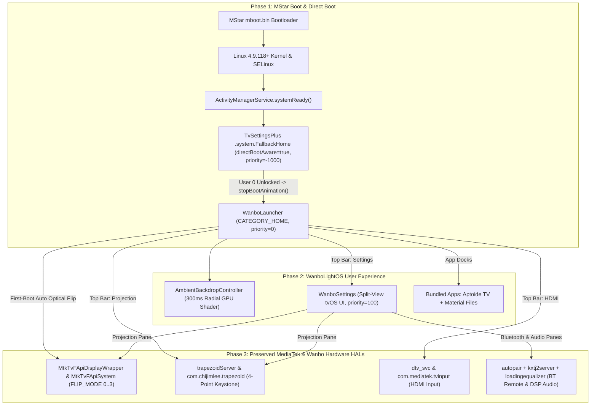

# WanboLightOS

> Lightweight, privacy-first custom operating system, tvOS-inspired Leanback launcher (`WanboLauncher`), and native Split-View settings suite (`WanboSettings`) engineered for the **Wanbo T2 Max Smart Projector** (`armeabi-v7a`, Android 9 Pie, API Level 28).
>
> **Project Notice:** This project was developed with heavy AI usage, encompassing AI-assisted firmware reverse engineering, automated pipeline scripting, and Android application development.

---

## Table of Contents

1. [Overview](#overview)
2. [Architectural Highlights](#architectural-highlights)
3. [What Is Pre-Installed vs. Removed](#what-is-pre-installed-vs-removed)
4. [Core Guarantees](#core-guarantees)
   - [1. Zero Telemetry & Privacy Preservation](#1-zero-telemetry--privacy-preservation)
   - [2. ~350 MB RAM Savings & Low-RAM Tuning](#2-350-mb-ram-savings--low-ram-tuning)
   - [3. 100% Hardware Preservation & Auto Optical Flip](#3-100-hardware-preservation--auto-optical-flip)
   - [4. Zero Emojis Policy](#4-zero-emojis-policy)
5. [Hardware Specifications & Compatibility](#hardware-specifications--compatibility)
6. [System Architecture Diagram](#system-architecture-diagram)
7. [Repository Directory Map](#repository-directory-map)
8. [Quick Start: Flashing via USB](#quick-start-flashing-via-usb)
9. [Quick Start: Building from Source](#quick-start-building-from-source)
10. [Automated Verification & Test Suites](#automated-verification--test-suites)
11. [AI Usage & Attribution](#ai-usage--attribution)
12. [License](#license)

---

## Overview

**WanboLightOS** is an open-source custom firmware distribution and application suite built specifically for the **Wanbo T2 Max** smart projector (MediaTek MT5862 / MStar T9255B platform, `armeabi-v7a`, Android 9 Pie, API Level 28, ~843 MB usable RAM). Stock firmware suffers from heavy advertising launchers (Whale TV / Zeasn), background telemetry daemons, obsolete casting servers (`EShareServer`, `EAirPlay` / `iMirror`, `EDLNA`), and sluggish webviews that consume over 600 MB of RAM at idle. WanboLightOS replaces the entire user-facing shell with a fast, 100% GPU-accelerated Apple TV (`tvOS`) aesthetic while preserving every hardware driver (4-point Keystone, HDMI input, MediaTek optical flip HAL, Bluetooth remote auto-pairing, and DSP audio equalizer).

---

## Architectural Highlights

### 1. tvOS-Inspired Leanback Launcher (`WanboLauncher`)
- **Dynamic Ambient Backdrop Glow (`AmbientBackdropController`):**
  - 100% GPU-rendered radial `GradientDrawable` shader (`1400px` radius) with zero bitmap memory overhead.
  - Smooth 300ms `ValueAnimator` + `ArgbEvaluator` color transitions that react in real time to the currently focused application card:
    - **YouTube / SmartTube:** Dark Crimson Red (`#5A0E13`)
    - **Netflix:** Dark Wine Red (`#4A0E17`)
    - **Disney+:** Dark Royal Blue (`#0C2340`)
    - **Amazon Prime Video:** Dark Navy / Cyan (`#0A253A`)
    - **Spotify:** Dark Emerald Green (`#0D3820`)
    - **Aptoide TV / VLC:** Dark Amber / Orange (`#4D260D`)
    - **Settings / Material Files:** Dark Cyan / Slate (`#0E2F44`)
    - **Jellyfin / Stremio:** Dark Indigo / Purple (`#2E104A`)
- **Transparent Top Shelf Hero Clock:**
  - Minimalist `48sp` thin typography digital clock (`clockHero`) over a `100%` transparent top shelf (`bg_top_shelf.xml`) so the ambient glow flows seamlessly across the entire 1080p canvas.
- **Dual-Row Floating Docks:**
  - **Row 1 (Favorites):** User-pinned favorite applications with `20dp` squircle cards, `+ Add` card modal, and long-press (`OK`) unpin dialog.
  - **Row 2 (All Applications):** Automatically discovers both Android TV Leanback (`CATEGORY_LEANBACK_LAUNCHER`) and standard sideloaded (`CATEGORY_LAUNCHER`) apps, sorted alphabetically with `1.08x` D-pad focus elevation (`150ms`).
- **1-Click Hardware Top Bar (`56dp`):**
  - Frosted-glass pill shortcuts for **HDMI** (`com.mediatek.tvinput`), **Projection / Keystone** (`com.chijimlee.trapezoid`), and **Settings** (`com.wanbo.settings`), plus live Wi-Fi status and date/time indicator.

### 2. Native tvOS Split-View Settings Suite (`WanboSettings`)
- Replaces the legacy settings menu (`android:priority="100"` across all `android.settings.*` intent filters) with a dedicated 2-column Split-View interface (`32%` Left Category Rail + `68%` Right Content Pane) driven by a deterministic D-pad state machine (`DpadFocusEngine`).
- **7 Built-in Configuration Panes:**
  1. **Network & Wi-Fi (`WifiPaneController`):** Automatically activates Android 9 High Accuracy Location Mode via `WRITE_SECURE_SETTINGS` and disables Wi-Fi scan throttling (`wifi_scan_throttle_enabled = 0`) so nearby 2.4 GHz / 5 GHz networks are discovered immediately, with signal bars (`dBm` to `%`) and WPA/WPA2/WEP/Open connection dialogs.
  2. **Bluetooth (`BluetoothPaneController`):** Power toggle, real-time discovery scan, automatic peripheral classification (*Remote Control*, *Audio*, *Others*), 1-click pairing (`createBond`), and unpairing (`removeBond`).
  3. **Projection & Display (`ProjectionPaneController`):** Direct reflection binding to MediaTek's Factory HAL (`MtkTvFApiDisplayWrapper.setMirrorMode(0..3)` and `MtkTvFApiSystem.setEmmcEnvVar("FLIP_MODE", ...)`) for all 4 optical mounting modes (*Front Desktop*, *Rear Desktop*, *Front Ceiling*, *Rear Ceiling*), 4-Point Keystone calibration shortcut, and Global Digital Zoom (`50%` to `100%`).
  4. **Sound & Audio (`AudioPaneController`):** Master volume progress control (`STREAM_MUSIC` with D-pad Left/Right support), audio output routing (*Internal Speaker*, *Bluetooth Audio*, *3.5mm Aux Output*), and 4 acoustic profiles (*Standard*, *Cinema*, *Music*, *Voice*).
  5. **Applications (`AppsPaneController`):** Real-time internal eMMC storage bar and application manager (Force Stop, Clear Cache, Uninstall) protected by `PROTECTED_HAL_KEYWORDS` so critical hardware drivers can never be stopped or uninstalled.
  6. **System (`SystemPaneController`):** Projector network name, 24h/12h clock toggle, timezone and system date shortcut, UI language selector, inactivity sleep timer (*Disabled*, *15m*, *30m*, *60m*, *120m*), USB Debugging toggle, and ADB over Wi-Fi (`TCP port 5555`).
  7. **About Projector (`AboutPaneController`):** Hardware specifications and a live 3-second real-time memory telemetry dashboard reading `/proc/meminfo` for physical RAM and ZRAM swap compression.

### 3. Automated OS Re-assembly Pipeline (`os-pipeline`)
- End-to-end Python pipeline (`build_rom.py`, `unsparse_system.py`, `modify_system_image.py`, `assemble_firmware.py`, `verify_assembled_firmware.py`) for MStar / MediaTek USB upgrade binaries (`T9255B_350R00_CC.bin`).
- Unsparses the 10 MStar `filepartload` sparse chunks into a `1.5 GB` raw ext4 image, purges bloatware, injects APKs and extracted `armeabi-v7a` JNI `.so` libraries (`lib/arm/*.so`) with `u:object_r:system_file:s0` SELinux attributes, patches `/system/build.prop`, re-encodes bitmap-balanced sparse chunks so Chunk 9 stays safely below the `32.48 MB` bootloader ceiling, and recalculates both the 16 KB Header CRC32 and whole-file XGIMI/MStar Footer CRC2.

---

## What Is Pre-Installed vs. Removed

### Pre-Installed Applications in WanboLightOS
| Application | Package Name | System Path | Purpose |
|:---|:---|:---|:---|
| **WanboLauncher** | `com.wanbo.launcher` | `/system/priv-app/WanboLauncher` | Default tvOS-inspired home screen (`priority="0"`) with zero internet permissions |
| **WanboSettings** | `com.wanbo.settings` | `/system/priv-app/WanboSettings` | Default Split-View settings suite (`priority="100"`) for Wi-Fi, BT, Projection, Audio, Apps, System, and RAM |
| **Aptoide TV** | `cm.aptoidetv.pt` | `/system/priv-app/AptoideTV` | Independent Android TV app store with extracted `librealm-jni.so` and privileged package install support |
| **Material Files** | `me.zhanghai.android.files` | `/system/app/MaterialFiles` | Modern open-source file manager (SMB, FTP, SFTP, USB, local storage) with extracted ARMv7 JNI libraries |
| **YouTube TV & Netflix** | `com.google.android.youtube.tv`, `com.netflix.ninja` | `/system/app` | Stock pre-certified streaming apps preserved from base ROM |

*(Note: Third-party apps such as SmartTube, Stremio, Jellyfin, and VLC are not pre-installed to keep `/system` lightweight, but their ambient backdrop color profiles are pre-registered in `AmbientBackdropController` so they light up automatically once installed via Aptoide TV).*

### Debloated / Removed Packages
- `TV_OPEN_LAUNCHER_WHALE-zvt_mtk9255_p_prod` & `Zeasn*` (stock ad-heavy launcher and telemetry)
- `EShareServer`, `EAirPlay` (`iMirror`), `EDLNA` (legacy background casting daemons)
- `MLocalMM2` (legacy crash-prone media manager, replaced by Material Files)
- `CleanCacheUtil` & `MemoryClean` (fake memory cleaner daemons)
- `Store_t_release_3.0.7_ZY_MTKWTV_3S`, `GeneralServices_ZY_MTKWTV_W_release_v2.0.9`, `dp-provider-Zhiyuan9255_2K_release_1.0.5`
- `Tubesky`, `LiveTVSetupWizard`, `WFDSinkTest`, `PrintSpooler`, `GoogleContactsSyncAdapter`, `CalendarProvider`, `ContactsProvider`

---

## Core Guarantees

### 1. Zero Telemetry & Privacy Preservation
- `WanboLauncher` omits `android.permission.INTERNET` entirely from its `AndroidManifest.xml` (verified by `ManifestSecurityTest.kt`).
- It cannot open network sockets, transmit analytics, or fetch remote ads.
- All Zeasn / Whale TV ad frameworks and background tracking services are permanently removed from the ext4 `/system` partition.

### 2. ~350 MB RAM Savings & Low-RAM Tuning
The Wanbo T2 Max has 1 GB physical DDR RAM (~843 MB usable by Android). By stripping background ad daemons and applying `/system/build.prop` low-RAM optimizations (`os-pipeline/patches/build.prop.patch`), WanboLightOS recovers **~350 MB of RAM**:
- `ro.config.low_ram=true`
- Custom Low Memory Killer thresholds (`ro.lmk.low=1001`, `ro.lmk.medium=800`, `ro.lmk.critical=0`)
- Tuned Dalvik VM heap parameters (`heapstartsize=8m`, `heapgrowthlimit=64m`, `heapsize=128m`)
- Full GPU OpenGL hardware composition (`debug.sf.hw=1`, `video.accelerate.hw=1`, `ro.hwui.renderer=opengl`)
- ZRAM idle compaction tuning (`ro.zram.mark_idle_delay_mins=60`)

### 3. 100% Hardware Preservation & Auto Optical Flip
WanboLightOS enforces `CRITICAL_HARDWARE_BLACKLIST` in `os-pipeline/build_rom.py` so critical vendor HALs and boot services are never removed:
- **Motorized & 4-Point Keystone Calibration:** Preserves `/vendor/bin/trapezoidServer`, `com.chijimlee.trapezoid`, and `com.chijimlee.tyylauncher` (which hosts the MediaTek `twoworlds.factory` JNI bridge).
- **Automatic Optical Mirror Compensation (`FLIP_MODE=1`):** Flashing `mboot.bin` resets the eMMC `FLIP_MODE` environment variable to `0`, which leaves the Wanbo T2 Max's internal angled mirror horizontally flipped on stock ROMs. `HardwareController.ensureDefaultOpticalOrientation()` automatically invokes `MtkTvFApiDisplayWrapper.getInstance().setMirrorMode(1)` and `MtkTvFApiSystem.getInstance().setEmmcEnvVar("FLIP_MODE", "1")` on first boot.
- **HDMI Input Switching (`dtv_svc` & `LiveTV`):** Preserves `/system/priv-app/LiveTV/LiveTV.apk` (`com.mediatek.tvinput`) for low-latency HDMI switching via the Top Bar shortcut while hiding `LiveTV` from the app drawer (`AppsRepository.EXCLUDED_PACKAGES`).
- **Android 9 Direct Boot Hand-off (`FallbackHome`):** Preserves `/system/priv-app/TvSettingsPlus/TvSettingsPlus.apk` (`com.android.tv.settings`, hidden from the app drawer) because Android 9's `ActivityManagerService.systemReady()` requires its `directBootAware="true"` `.system.FallbackHome` activity (`priority="-1000"`) during Phase 1 boot to stop the `"android"` boot animation and hand off to `WanboLauncher` (`priority="0"`).
- **Bluetooth Remote & DSP Equalizer:** Preserves `kxtj2server`, `com.mediatek.autopair`, `com.mediatek.hotkey.dispatcher`, and `com.mediatek.loadingequalizer`.

### 4. Zero Emojis Policy
In accordance with professional operating system standards, WanboLightOS enforces a strict Zero Emojis policy across all application layouts, settings strings, log messages, documentation, and build scripts.

---

## Hardware Specifications & Compatibility

| Parameter | Specification |
|:---|:---|
| **Device Model** | Wanbo T2 Max (Smart Projector, Android 9 Edition) |
| **Board / Bootloader ID** | `T9255B_350R00_CC` (MStar / MediaTek MT5862 / MSD6A358) |
| **System Architecture** | `armeabi-v7a` (32-bit ARMv7, 4x Cortex-A53) |
| **Operating System** | Android 9 Pie (API Level 28) |
| **System RAM** | 1 GB physical (~843 MB usable + LZ4 ZRAM swap) |
| **Internal Storage** | 16 GB eMMC flash |
| **Native Resolution** | 1920 x 1080 (Full HD 1080p) |
| **Connectivity** | Wi-Fi 802.11 b/g/n, Bluetooth 4.0, HDMI, USB 2.0, 3.5mm Aux P2 |

---

## System Architecture Diagram



---

## Repository Directory Map

```text
wanbo-light-os/
|-- Makefile                          Root orchestration Makefile (help, launcher, test, rom, clean)
|-- LICENSE                           GNU General Public License v3.0 (GPL-3.0)
|-- README.md                         Complete project documentation (this file)
|-- dist/
|   `-- USB_DRIVE/
|       `-- T9255B_350R00_CC.bin      Ready-to-flash MStar USB firmware binary (1,601,388,576 bytes)
|-- docs/
|   |-- how-to-flash.md               End-user 7-step USB thumb drive flashing instructions
|   |-- how-to-build.md               Developer guide for compiling APKs and assembling the ROM
|   `-- tests/
|       `-- test_docs.py              Automated documentation & Zero Emojis verification suite
|-- launcher/                         WanboLauncher: tvOS-Inspired Android TV Home Screen
|   |-- build.gradle.kts              Root Gradle configuration
|   `-- app/
|       |-- build.gradle.kts          App Gradle config (armeabi-v7a, API 28)
|       `-- src/
|           |-- main/
|           |   |-- AndroidManifest.xml Zero-INTERNET manifest with HOME & LEANBACK_HOME
|           |   |-- java/com/wanbo/launcher/
|           |   |   |-- MainActivity.kt               Dual-row docks, Top Bar, auto optical flip
|           |   |   |-- data/AppsRepository.kt        App discovery & system package exclusion
|           |   |   |-- data/FavoriteAppsManager.kt   SharedPreferences favorites persistence
|           |   |   |-- hardware/HardwareController.kt HDMI, Keystone, Settings & MediaTek Flip HAL
|           |   |   |-- model/AppItem.kt              Application domain model
|           |   |   `-- ui/                           AmbientBackdropController, Adapters
|           |   `-- res/                              Layouts, vector drawables, transparent top shelf
|           `-- test/java/com/wanbo/launcher/         7 JUnit4 test suites for launcher
|-- settings/                         WanboSettings: Native tvOS Split-View Settings Application
|   |-- build.gradle.kts              Root Gradle configuration
|   `-- app/
|       |-- build.gradle.kts          App Gradle config (armeabi-v7a, targetSdk 22 for auto permissions)
|       `-- src/
|           |-- main/
|           |   |-- AndroidManifest.xml Priority 100 settings intent filters & system permissions
|           |   |-- java/com/wanbo/settings/
|           |   |   |-- SettingsActivity.kt           2-column Split-View host & D-pad router
|           |   |   |-- model/SettingsCategory.kt     7 settings categories & intent mappings
|           |   |   |-- panes/                        Wifi, Bluetooth, Projection, Audio, Apps, System, About
|           |   |   |-- ui/                           CategoryRailAdapter & DpadFocusEngine
|           |   |   `-- util/MemInfoReader.kt         Live /proc/meminfo RAM & ZRAM parser
|           |   `-- res/                              Split-View layouts, cards, badges, drawables
|           `-- test/java/com/wanbo/settings/         5 JUnit4 test suites for settings
`-- os-pipeline/                      Automated Firmware Unpack, Debloat, Injection & Repack Suite
    |-- build_rom.py                  9-step CLI pipeline orchestrator & HAL safety verifier
    |-- build-rom.sh                  POSIX shell wrapper for build_rom.py
    |-- unsparse_system.py            Extracts 10 MStar sparse system chunks into raw ext4 image
    |-- modify_system_image.py        In-place debugfs debloat, APK + JNI lib injector & build.prop patcher
    |-- assemble_firmware.py          Bitmap-aware sparse chunk encoder & MStar CRC1/CRC2 assembler
    |-- verify_assembled_firmware.py  Verifies Header CRC, Footer CRC2, sparse chunks & e2fsck integrity
    |-- patches/
    |   |-- debloat-list.txt          Wildcard-enabled bloatware removal specification
    |   `-- build.prop.patch          Low-RAM, Dalvik heap, GPU OpenGL & ZRAM properties
    `-- tests/
        |-- test_patches.py           Unit tests for debloat-list.txt & build.prop.patch
        `-- test_build_pipeline.py    Unit tests for build_rom.py & HAL safety blacklist
```

---

## Quick Start: Flashing via USB

For detailed troubleshooting, see the complete [USB Flashing Guide](docs/how-to-flash.md).

### Step-by-Step USB Flashing Procedure
1. **Format USB Drive:** Format a 4 GB - 32 GB USB drive as **FAT32** with an **MBR** partition table (do not use exFAT, NTFS, or GPT).
2. **Copy Firmware Binary:** Copy `dist/USB_DRIVE/T9255B_350R00_CC.bin` directly to the **root directory** of the USB drive (`E:\T9255B_350R00_CC.bin`).
   - *Note:* The MStar `T9255B` bootloader specifically looks for `T9255B_350R00_CC.bin` on the root of the FAT32 drive.
3. **Power Off:** Unplug the Wanbo T2 Max power cable completely and wait 10 seconds.
4. **Insert USB Drive:** Plug the USB drive into the rear USB port of the projector.
5. **Trigger MStar Upgrade:** Press and **hold down** the physical Power button on top of the projector while plugging the power cable back in.
6. **Wait for Progress Bar:** Keep holding the Power button for **5 seconds** until the MStar upgrade screen appears, then release.
7. **Automatic Reboot:** Wait **2-3 minutes** for flashing to reach 100%. The projector will automatically reboot into **WanboLightOS** and apply the optical mirror orientation (`FLIP_MODE=1`) automatically.

---

## Quick Start: Building from Source

For detailed instructions on prerequisites (`Python 3`, `JDK 17`, `Android SDK`, `WSL` / Linux ext4 tools), see the [Build Guide](docs/how-to-build.md).

### 1. Compile and Sign `WanboLauncher` & `WanboSettings` APKs
```bash
# Compile and run unit tests for WanboLauncher
cd launcher && ./gradlew testReleaseUnitTest assembleRelease --no-daemon && cd ..

# Compile and run unit tests for WanboSettings
cd settings && ./gradlew testReleaseUnitTest assembleRelease --no-daemon && cd ..

# Copy and sign with V1 + V2 + V3 schemes (required by Android 9 PackageManagerService)
cp launcher/app/build/outputs/apk/release/app-release.apk build/WanboLauncher.apk
cp settings/app/build/outputs/apk/release/app-release.apk build/WanboSettings.apk

apksigner sign --ks ~/.android/debug.keystore --ks-pass pass:android --key-pass pass:android \
  --ks-key-alias androiddebugkey --min-sdk-version 21 \
  --v1-signing-enabled true --v2-signing-enabled true --v3-signing-enabled true build/WanboLauncher.apk

apksigner sign --ks ~/.android/debug.keystore --ks-pass pass:android --key-pass pass:android \
  --ks-key-alias androiddebugkey --min-sdk-version 21 \
  --v1-signing-enabled true --v2-signing-enabled true --v3-signing-enabled true build/WanboSettings.apk
```

### 2. Unsparse, Customize, Assemble, and Verify the Firmware Image
```bash
# 1. Extract clean 1.5 GB raw ext4 system image from stock binary
python3 os-pipeline/unsparse_system.py

# 2. Apply debloat, inject WanboLauncher, WanboSettings, AptoideTV (+ JNI libs), MaterialFiles (+ JNI libs), and patch build.prop
python3 os-pipeline/modify_system_image.py

# 3. Encode 10 sparse chunks, update MStar header script, and compute Header CRC + Footer CRC2
python3 os-pipeline/assemble_firmware.py

# 4. Verify Header CRC, Footer CRC2, sparse chunk decoding, and ext4 e2fsck integrity
python3 os-pipeline/verify_assembled_firmware.py

# 5. Copy verified binary to USB distribution folder
cp build/WanboLightOS_v1.0.bin dist/USB_DRIVE/T9255B_350R00_CC.bin
```

Or using the standard `Makefile` targets:
```bash
make launcher
make test
make rom INPUT_FW=stock_firmware.bin OUTPUT_FW=WanboLightOS_v1.0.bin
```

---

## Automated Verification & Test Suites

Run the complete test suite across all modules:

```bash
# Pipeline & Debloat / build.prop Unit Tests (41 tests)
python3 -m unittest discover -s os-pipeline/tests -p "test_*.py" -v

# Documentation & Zero Emojis Compliance Tests (5 tests)
python3 -m unittest discover -s docs/tests -p "test_*.py" -v

# WanboLauncher JUnit4 Suite
cd launcher && ./gradlew testReleaseUnitTest && cd ..

# WanboSettings JUnit4 Suite
cd settings && ./gradlew testReleaseUnitTest && cd ..
```

---

## AI Usage & Attribution

This project was developed with heavy AI usage throughout every development phase:
- **Firmware Reverse Engineering:** Analyzing MStar / MediaTek T9255B partition schemes, sparse ext4 chunk limits, and proprietary hardware HAL bindings (`MtkTvFApiDisplayWrapper`, `twoworlds.factory`).
- **OS Pipeline Automation:** Authoring Python automation scripts (`build_rom.py`, `unsparse_system.py`, `modify_system_image.py`, `assemble_firmware.py`, `verify_assembled_firmware.py`) and MStar CRC calculation tools.
- **Native Android Applications:** Architecting and implementing `WanboLauncher` and `WanboSettings` with GPU-accelerated tvOS shaders, D-pad deterministic state machines, and direct vendor HAL integration.
- **Testing & Verification:** Comprehensive automated test suites across documentation, pipeline safety invariants, and Android unit tests.

---

## License

WanboLightOS is open-source software licensed under the **GNU General Public License v3.0 (GPL-3.0)**. See the [LICENSE](LICENSE) file for the complete license terms and conditions.
